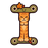

# 🍂 Autumn Cat Cursors (Frog Hood Edition)

> An adorable, cozy autumn-themed mouse cursor pack featuring a golden tabby cat in a green frog hoodie surrounded by swirling fall foliage.


---

## 🎨 Preview & Cursor States

| State | Preview (48px) | Description | Hotspot | Animation |
| :--- | :---: | :--- | :---: | :---: |
| **Normal Select** (`default`, `left_ptr`) |  | Classic pointer arrow framed with the cozy frog cat | `(6, 2)` | Static |
| **Link Select** (`pointer`, `hand2`) |  | Pointing kitten finger for clickable links & buttons | `(16, 2)` | Static |
| **Text Select** (`text`, `xterm`) |  | Symmetrical I-beam with cat body & frog eye accents | `(24, 24)` | Static |
| **Precision Select** (`crosshair`, `cross`) |  | Crosshair reticle with kitten face center | `(24, 23)` | Static |
| **Busy / Wait** (`wait`, `watch`) |  | Swirling autumn maple leaves loading animation | `(24, 24)` | 8 Frames (120ms) |
| **Working in Background** (`progress`) |  | Arrow pointer with revolving maple leaves | `(6, 2)` | 8 Frames (120ms) |

---

## ✨ Features

* **Multi-Resolution Native Rendering:** Pre-rendered at `24px`, `32px`, `48px`, and `64px` using high-precision Lanczos downsampling from $1254 \times 1254$ vector artwork. Zero runtime blurring.
* **Full Wayland & X11 Compatibility:** Works seamlessly across GNOME, KDE Plasma, XFCE, and modern Wayland compositors (Sway, Hyprland).
* **System Inheritance Fallback:** Inherits from `Yaru` and `Adwaita`, ensuring secondary cursors (resize arrows, not-allowed, etc.) always display without missing icons.
* **Pre-compiled Binaries:** Ready-to-use binaries in `dist/autumn-cat-cursors` — no compiler dependencies needed for standard installation.

---

## 🚀 Installation (Linux)

### Method 1: Automated Script (Recommended)

Clone the repository and run the installer:

```bash
git clone https://github.com/your-username/autumn-cat-cursors.git
cd autumn-cat-cursors

# Install for current user (default: ~/.local/share/icons/)
./install.sh --user
```

To install system-wide (accessible to GDM login screen, Flatpaks, and Snaps):

```bash
sudo ./install.sh --system
```

### Method 2: Manual Installation

1. Copy the precompiled theme folder:

   ```bash
   mkdir -p ~/.local/share/icons
   cp -r dist/autumn-cat-cursors ~/.local/share/icons/
   ```

2. Activate via GNOME settings:

   ```bash
   gsettings set org.gnome.desktop.interface cursor-theme 'autumn-cat-cursors'
   ```

   *(Or select **Autumn Cat Cursor** inside GNOME Tweaks).*

---

## 📏 Adjusting Cursor Size

You can switch between pre-rendered sizes anytime:

```bash
# Medium (32px - Recommended for 1080p / 1440p)
gsettings set org.gnome.desktop.interface cursor-size 32

# Large (48px - Great for High-DPI screens)
gsettings set org.gnome.desktop.interface cursor-size 48

# Extra Large (64px)
gsettings set org.gnome.desktop.interface cursor-size 64

# Small (24px - Default compact)
gsettings set org.gnome.desktop.interface cursor-size 24
```

---

## 🛠️ Building from Source

To customize hotspots or generate additional resolutions:

1. Requirements:

   ```bash
   sudo apt install x11-apps python3-pil
   ```

2. Run the compiler:

   ```bash
   python3 build.py
   ```

   The compiled binaries and symlinks will be written to `dist/autumn-cat-cursors/`.

---

## 🌐 Web & Interactive Sandbox

Test the cursors live in your browser using the included [index.html](./index.html):

```bash
xdg-open index.html
```

---

## 🗑️ Uninstallation

To revert to the system default cursor theme (`Yaru`):

```bash
./install.sh --uninstall
```

---

## 📄 License

Distributed under the [MIT License](./LICENSE). Artwork and theme packaged with care.
